# 半导体
## 概念
导电能力介于导体和绝缘体之间的材料

# 本征半导体
## 概念
纯净的、具有晶体结构的半导体

硅、锗四价元素，大多数金属氧化物、金属硫化物

## 晶体结构

## 载流子
承载电流的粒子：自由电子和空穴

半导体也是能够导电的，导电靠**自由电子**

### 载流子如何产生
**本征激发**：由于热运动，价电子逃离共价键的束缚。留下带正点的空穴和负电的电子

自由电子：给半导体施加一个电场，沿电场方向，自由电子移动

空穴：共价键中的价电子随电场力移动到空穴中，留下一个空穴，下一个价电子也移动到空穴中，价电子依次填补空穴，空穴也沿着电场方向移动

>有其正向运动，必然有其逆向运动

**复合**：当自由电子遇上空穴，一对自由电子——空穴对就形成了共价键

### 载流子浓度
本征半导体的导电能力与**载流子的浓度**相关

载流子的浓度与**本征激发和复合的速度**有关

本征激发的速度与**温度**相关

复合的速度与载流子的浓度相关

温度达到一定程度后本征激发和复合达到动态平衡，载流子的浓度趋于稳定

# 杂质半导体
## 概念
为了提高本征半导体的导电能力，利用可掺杂性

在本征半导体中参入**少量**杂质元素

## N型半导体
掺入5价磷(P)元素，拥有大量的自由电子，带负电（只有四个电子的磷粒子带正电，但它不会移动，故不产生电。不影响N型半导体带负电）

多子为自由电子

少子为空穴

温度对多子影响不大，对少子影响很大。因其基数不同。（温度影响本征激发，产出自由电子和空穴）

## P型半导体
掺入3价硼(B)元素，拥有大量的空穴，带正电

多子为空穴

少子为自由电子

# PN结
## 形成
扩散运动：粒子从浓度高向浓度低运动

空间电荷区：耗尽层、阻挡层、PN结。扩散运动后形成空间电场、势垒，阻挡粒子的移动。当有粒子冲破势垒仍然会有扩散运动。

漂移运动：少子在空间电荷区的作用下运动，与多子的扩散运动达到动态平衡

对称结：PN结两边宽度一样，因其两边掺杂浓度一致。
不对称结：浓度高的窄，浓度低的宽。

## 单向导电性
### 外加正向电压
死区：加正向电压没有电流

外电场削弱内电场作用，使扩散运动得以恢复

电阻的作用：对电流加以限制，防止PN结烧掉。
$$
I=\frac{U}{R}
$$

### 外加反向电压
内外电场一致，PN结变厚

加强漂移运动，但电流微小（微安极），对温度敏感

## 伏安特性曲线

### 正向特性
电流方程
$$
i=I_s(e^{\frac{U}{U_T}}-1)
$$

$I_s$反向饱和电流，$U_T$是一个温度当量，将温度转换为电压表达。室温下$U_T=26mV$

导通电压：锗管0.2~0.3V，硅管0.6~0.7V。方程中“-1”基本可忽略

### 反向特性
$I_s$反向饱和电流，锗管比硅管大
#### 反向击穿
1、雪崩击穿：**掺杂浓度低**，PN结宽，反向电场长度长。不断增加反向电压，PN结变成粒子加速器，自由电子进入后被加速，当撞到共价键撞开后，就逐渐有越来越多自由电子。温度越高，造成击穿的电压越高。（因其需要电子被加速，温度越高容易撞上其他电子使得电子得不到加速。电压越高得到更多能量）

2、齐纳击穿：**掺杂浓度高**,PN结窄，场强会很大，价电子容易克服共价键束缚后击毁共价键。温度越高，造成击穿的电压越低

#### PN结损坏
反向击穿引起PN结温度升高。电功率为$P=UI$均用于发热，造成热击穿，使得PN结损坏

若未使温度升高，PN结不损坏则工作在反向击穿状态

#### 工程作用
在反向击穿区域中，很大的电流变化并不会造成很大的电压变化，有稳定电压的作用。即稳压二极管

通过掺杂浓度控制反向击穿电压大小。浓度越低，反向击穿电压越大

## 电容效应
电容，反应在相同的电压下，不同的电荷量存储量

>一个器件因电压变化，造成电荷量也会变化，反映其电容特性

### 势垒电容
电荷量变化发生在势垒（耗尽层）中。非线性变化，为可变电容

### 扩散电容
当N区的电子移动到P区，沿着耗尽层的边缘向P区的方向，电子浓度逐渐递减，变成了**非平衡少子**（不是P区自身的）。其电子过来的多少与电压相关，形成扩散电容。

P区的空穴移动到N区也是一样的道理

扩散电容由非平衡少子和电压间的关系构成

$n_P$为P区中非平衡少子浓度，电压升高①变为②，电压降低①变为③

# 半导体二极管
将PN结包装，引出引脚

## 伏安特性
1、体电阻的存在，电流比PN结小
2、反向电流大点

## 温度的影响
温度升高，热运动加剧，本征激发多，相同电压下，温度高的电流比温度低的大

温度升高对少子影响更大，反向饱和电流变大

室温下，每升高1℃，正向压降减小2-2.5mV。每升高10℃，反向饱和电流增大一倍

## 作用
>1、整流：规定电流路径 
2、钳位：正向导通电压近似认为固定，将电压固定在导通电压上 
3、反向饱和电流，可以当作温度传感器，因温度升高，反向饱和电流增大 
4、稳压：工作在反向击穿区域。反向击穿电压可变，因掺杂浓度改变

## 主要参数
### $I_F$最大整流电流
二极管长期工作所能通过的正向平均电流的最大值

### $U_R$最高反向电压
大概为50%的反向击穿的最大电压，留一点余量，允许超过

### $I_R$反向饱和电流
越小反向截止的特性越好

### $f_M$最高工作频率
二极管能够保持其核心功能（如单向导电性、整流或检波）正常发挥的最高交流信号频率

影响因素：结电容（势垒电容和扩散电容）和反向恢复时间

## 等效电路
（a）为理想二极管和其符号。

一般使用（b），理想二极管+开通压降（其导通压降近似不变）

二极管导通，电流会随着电压变化，但电流变化范围大其对应的电压范围小，所以等效为固定电压，并不代表电压是不变的

## 例题
### 1、画出$U_o$的波形

**思路**：1、二极管截止，电路中没有电流，电阻不分压，$U_o=U_s$。2、二极管导通后，电路中产生电流，电阻分压，$U_o=U_{ON}+U_1$

限幅

### 2、整流

## 微变等效
### 想将小交流通过二极管在R上表现出来，计算电路电流

假设二极管开通电压为0.6V，小交流为10mV

加个直流将二极管导通

### 在交流电压下如何估算当前二极管的电阻
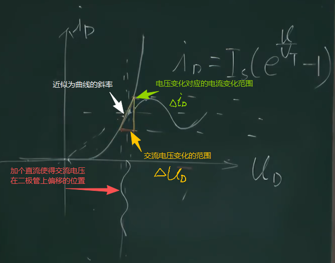

$\frac{1}{r_d}=\frac{\triangle i_D}{\triangle u_D}=\frac{di_D}{du_D}$即对电流公式求导

$\frac{di_D}{du_D}=I_s \cdot \frac{1}{U_T} \cdot e^{\frac{u_D}{U_T}}\approx\frac{I_D}{U_T}$

动态电阻
$$r_d=\frac{U_T}{I_D}$$

$I_D$为静态电流大小，即在图上过哪个点做的切线，即直流电压对应的电流大小。$U_T$为温度当量。所以动态电阻与温度相关与静态点相关

### 分析过程
1、分析直流，求出静态工作点的$I_D$，可用估算，二极管等效为理想二极管+开通压降。$$I_D=\frac{V-U_{ON}}{R}$$

2、$r_d=\frac{U_T}{I_D}$，二极管等效为$r_d$电阻
$$r_d=\frac{U_T}{I_D}$$

3、去掉直流V。计算交流电流

因之前分析都是为了将坐标原点往前移，转移到计算二极管电阻的点，使得在一小段范围中二极管呈现线性电阻。直流电压为了移动坐标轴，当移动完毕后，计算交流电流时，需要去掉直流电压

$$i_d=\frac{u_i}{r_d+R}$$

4、整个电流为静态工作点电流+交流电流
$$i_D=I_D+i_d$$

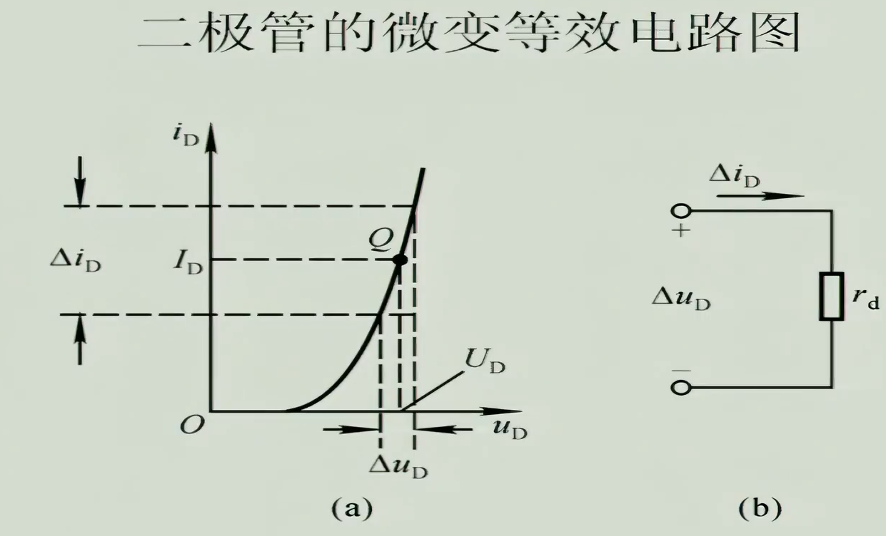
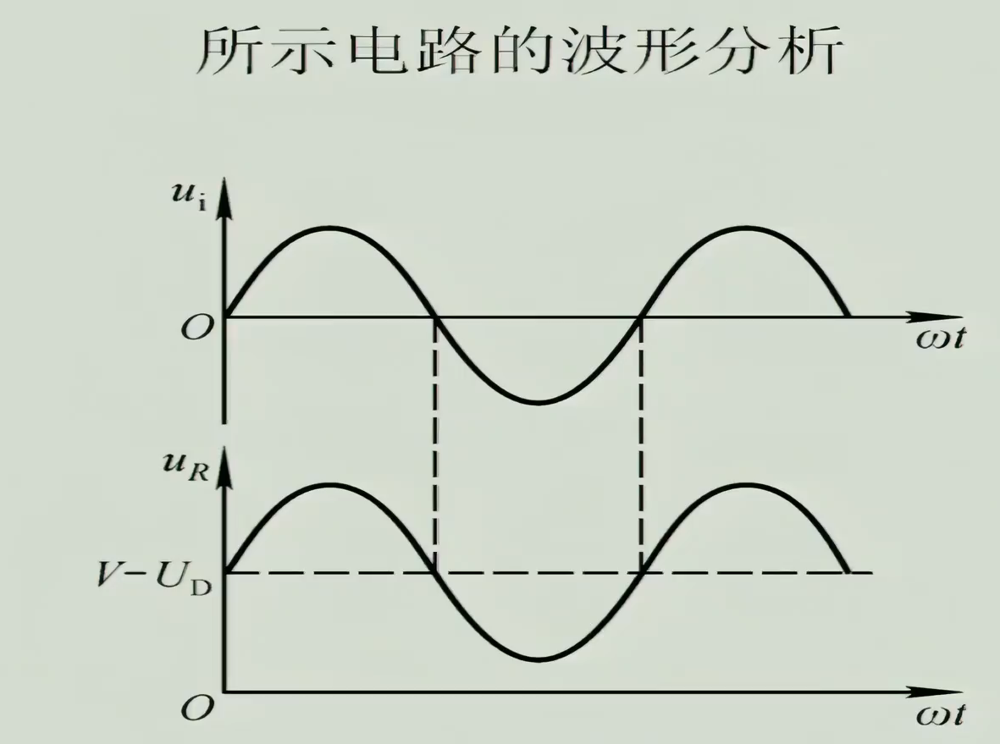

## 稳压二极管
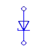
### 特点
工作在反向击穿状态下

很大电流变化范围内，电压变化很小

需要散热以防造成热击穿

### 伏安特性
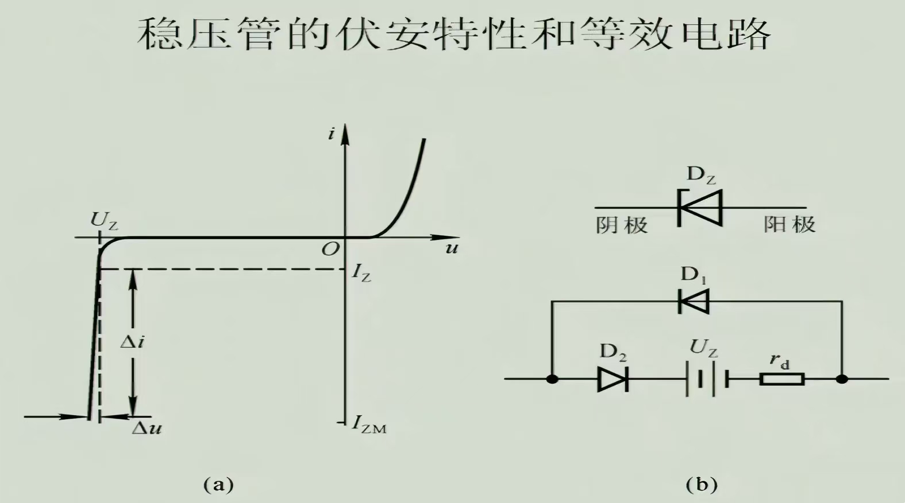

### 主要参数
1、稳定电压$U_Z$：在反向击穿区，通过额定电流时，管子两端稳定下来的电压值

2、额定工作电流$I_{ZT}$：稳压管可以长时间稳定工作，并且稳压性能最好时对应的工作电流值

3、最小稳定电流$I_{ZK}$：保证管子进入击穿区、开始发挥稳压功能的最小电流

4、最大稳定工作电流$I_{ZM}$：管子能承受的最大反向电流。超过$I_ZM$，管子会因过热而永久损坏

5、最大耗散功率：可以稳定工作的最大功率值，在工作电路中稳压管的功率不应超过这个值

6、动态电阻$R_Z$：等于电压变化量除以电流变化量 （$R_Z =\frac{\triangle U_Z}{\triangle I_Z}$）。Rz越小，说明电流变化时电压波动越小，稳压效果越好

7、温度系数CTV或$\alpha$：反映了稳定电压受温度影响的程度。定义为温度每变化1℃，$U_Z$的相对变化量。系数越小，表示管子受温度影响越小，电压越稳定

- 低于6V的稳压管（齐纳击穿），温度系数通常为负（稳定电压随温度升高而降低）。

- 高于6V的稳压管（雪崩击穿），温度系数通常为正（稳定电压随温度升高而升高）。

- 约为6V的稳压管，两种效应抵消，温度系数最低。

### 稳压电路
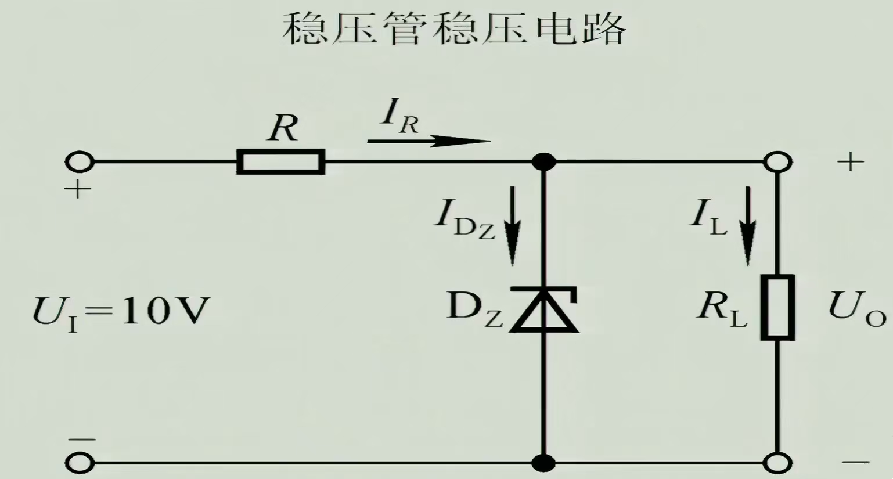

(1)$U_Z=6V$，$R=0.2kΩ$，$R_L=0.8kΩ$，计算$I_{DZ}$
$$
\begin{gathered}
I_{DZ}=I_R-I_L \\
U_O=U_Z \\
I_L=\frac{U_O}{R_L} \\
I_R=\frac{U_R}{R}=\frac{U_1-U_O}{R} \\
I_{DZ}=I_R-I_L=\frac{U_1-U_Z}{R}-\frac{U_Z}{R_L}=12.5mA
\end{gathered}
$$

(2)$U_Z=6V$，$R=0.8kΩ$，$R_L=0.2kΩ$，计算$I_{DZ}$

按照上述想法$$I_{DZ}=I_R-I_L=\frac{U_1-U_Z}{R}-\frac{U_Z}{R_L}=-25mA$$

所以稳压二极管未击穿

>要先判断稳压二极管是否击穿 
设未击穿，则无电流通过二极管，$U_O=\frac{U_1}{R+R_L} \cdot R_L=\frac{10V}{0.8kΩ+0.2kΩ} \cdot 0.2kΩ=2V \lt U_Z=6V$

## 发光二极管
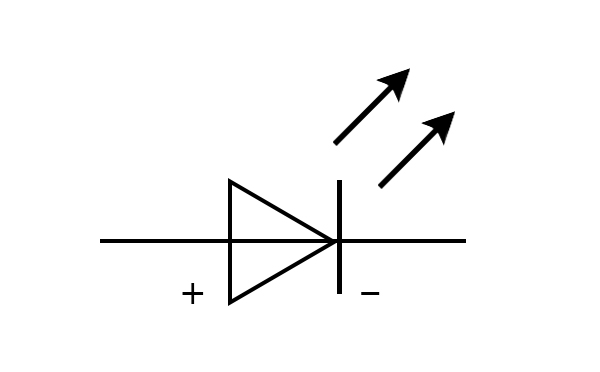
**电致发光**效应。当给它施加正向偏压（P区接正，N区接负）时，多数载流子（电子和空穴）相互注入并复合，复合时释放的能量以光子形式辐射出来，从而发光。

## 光电二极管
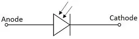

**内光电**效应。当光照射到PN结时，光子能量被半导体吸收，激发出新的“光生电子-空穴对”。在耗尽层内建电场的作用下，这些载流子发生分离，从而在外部电路中产生光电流，实现“光→电”转换。

# 晶体管
## 双极晶体管（BJT）
也称半导体三极管
### 结构
集电区——集电极c：收集载流子（仓库），掺杂浓度最低，但面积最大

集电结

基区——基极b：控制区，非常的薄，掺杂浓度低

发射结

发射区——发射极e：发射载流子，掺杂浓度最高（有丰富的载流子）

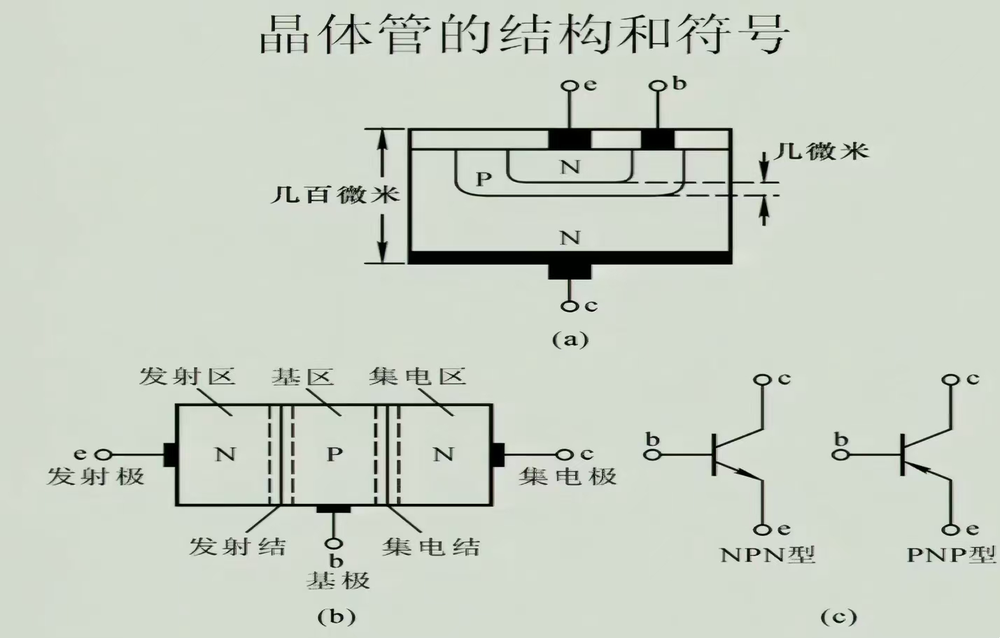

### 电流放大作用
#### 放大
$\frac{I_c}{I_b}$是一个常数，即$I_c$随着$I_b$的变化而变化

原理：三极管**控制**电源能量发生改变

放大的基本要求：不能失真

#### 基本共射放大电路
$V_{BB}$作用：使发射结导通

$R_b$作用：限流电阻，保护电路。二极管、三极管导通电压大致为0.6-0.7V，很小的电压变化也会引起很大的电流

正向偏置（正偏）：PN结正向导通

反偏：PN结反向截止

$V_{CC} \gt V_{BB}$，发射结正偏，集电结反偏
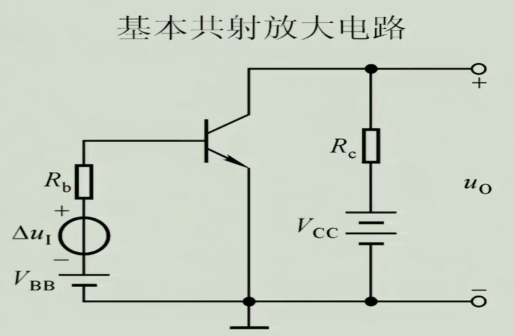

#### 内部载流子运动
1、发射结正偏：扩散运动恢复。发射区的自由电子向基区扩散（$I_{EN}$），基区的空穴向发射区扩散（$I_{EP}$）（发射区掺杂浓度最高，故$I_{EN}$很大）

2、基区：①扩散②复合③产生空穴

从发射区扩散过来的非平衡少子比基区的多子还要多，继续向集电区扩散。（如果基区很宽，掺杂浓度高会导致从发射区扩散过来的非平衡少子在基区大部分被复合，故基区薄且掺杂浓度低）。基区掺杂浓度基本不变，有多少复合（来自发射区）就容易有多少空穴（来自集电区）产生。由于复合比例固定，$I_B$和$I_C$就容易成比例。（复合速度还和浓度梯度有关）

3、集电结反偏：自由电子被集电区收集，保证了浓度梯度的正常。还有少子的漂移。（掺杂浓度最低，形成较宽的耗尽层，有较大的击穿电压）

$I_{CN}$和$I_{BN}$成比例

$$
\begin{gathered}
I_B=I_{EP}+I_{BN}-I_{CBO}\\
I_C=I_{CN}+I_{CBO}
\end{gathered}
$$
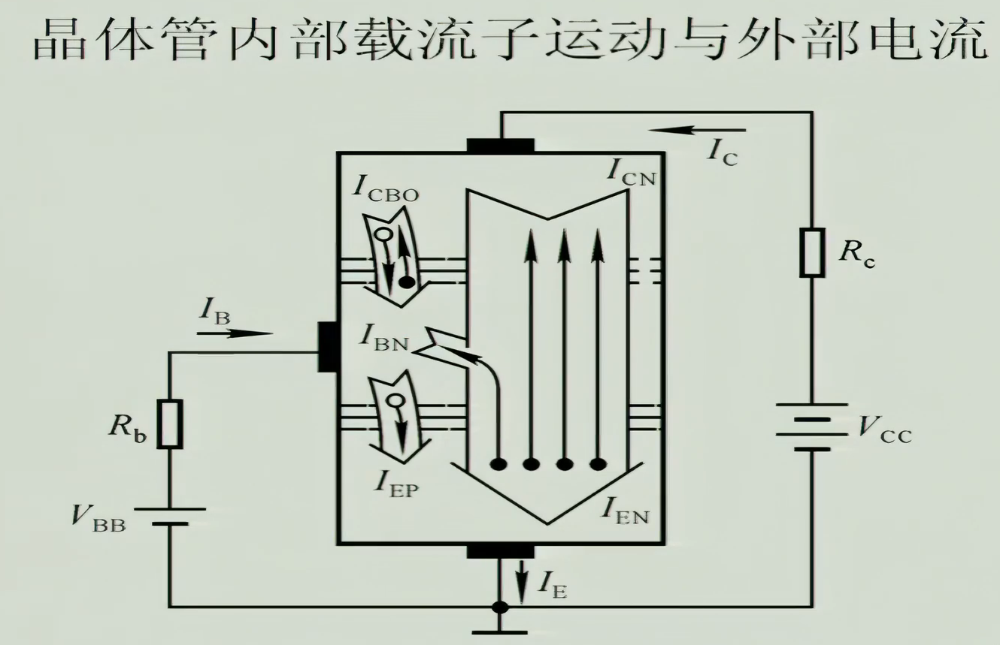

#### 放大系数
1、$\beta$

##### 共射

直流电流放大系数
$$\bar{\beta}=\frac{I_{CN}}{I_{BN}}=\frac{I_C-I_{CBO}}{I_B+I_{CBO}} \approx \frac{I_C}{I_B}$$

交流电流放大系数
$$\beta=\frac{\triangle I_C}{\triangle I_B}$$

其大小相近

##### 共基
$$\bar{\alpha}=\frac{I_{C}}{I_{E}}=\frac{\bar{\beta}}{1+\bar{\beta}}$$
交流电流放大系数也与其类似

2、$I_{CEO}$

当$I_B=0$，基极开路时，还有一个$I_c$，也为$I_{CEO}$，穿透电流，从c区流向e区

3、$I_{CBO}$

反向电流

## 场效应管（FET）
1、几乎无功率

电场效应，无电流，输入电阻非常大

2、受温度影响小

双极型->同时有两种电子导电，受温度影响大

场效应管只有多子惨参与导电，受温度影响小

### 绝缘栅型场效应管（MOSFET）
#### N沟道增强型MOS管 
##### 结构
栅极g：控制极

源极s：载流子源泉

漏极d：载流子漏出  

箭头指向PN结方向
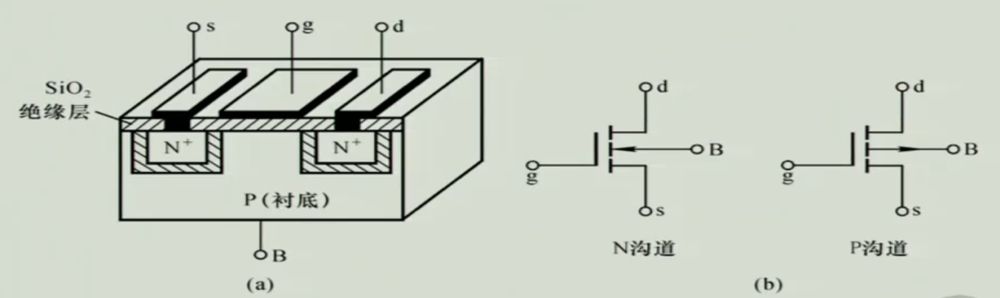

##### 工作原理
（1）$U_{DS}=0$，$U_{GS} > 0$

形成电场，空穴在电场作用下往下移动形成耗尽层。P的自由电子吸引到g

$U_{GS}$不变，沟道宽度不变，宽度决定电阻

得到一个可用电压控制的可变电阻

$U_{GS}$决定$R_{DS}$，此时在DS上加电压就会有电流
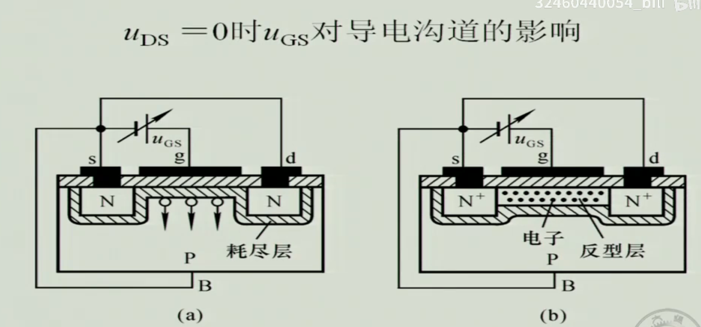

(2)$U_{GS} > U_{GS(th)}$形成沟道，保持不变，$U_{DS} \uparrow$

$U_{GS(th)}$开启电压

前半段，$U_{GS}$不变，此时$R_{DS}$不变

沟道宽窄与上下的电压有关

左边电压差为$U_{GS}$，不变

右边电压差为$U_{GS} - U_{DS}$，变小

预夹断：$U_{GS} - U_{DS} = U_{GS(th)}$（不会夹断，会变成一条很小的缝隙）

继续加大$U_{GS}$，$R_{DS}$变大，$I_{d}$基本不变
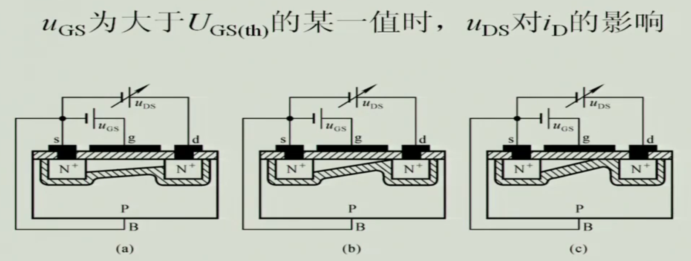

$U_{GS}$在前半段决定了$R_{DS}$大小；$U_{GS}$不变$R_{DS}$不变；$U_{GS}$大的$R_{DS}$大

后半段$U_{GS} - U_{DS} = U_{GS(th)}$，出现预夹断，$I_{D}$基本不变，$U_{DS}$越大，$R_{DS}$越大

而后半段的$I_{D}$与$U_{GS}$成比例

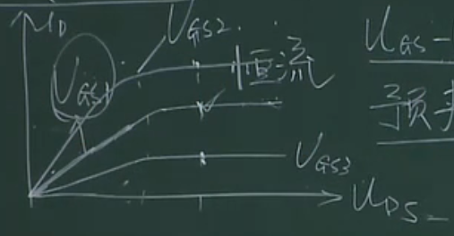
总结：

（1）当$U_{GS} > U_{GS(th)}$，形成一个个可变电阻，也必须有这个条件才能导通，所以叫增强型

（2）当$U_{DS} \uparrow$，$U_{GS} - U_{DS} < U_{GS(th)}$，可以控制$U_{GS}$放大$I_{D}$

#### N沟道耗尽型MOS管
$SiO_2$拥有大量正电，天生产生沟道

$U_{GS(off)}$夹断电压，当$U_{GS} < U_{GS(off)}$，将沟道关断
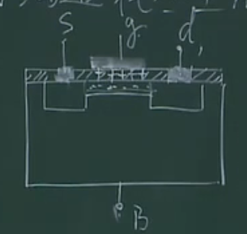
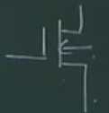

### 结型场效应管

天生导通，即天生$U_{GS} > U_{GS(th)}$
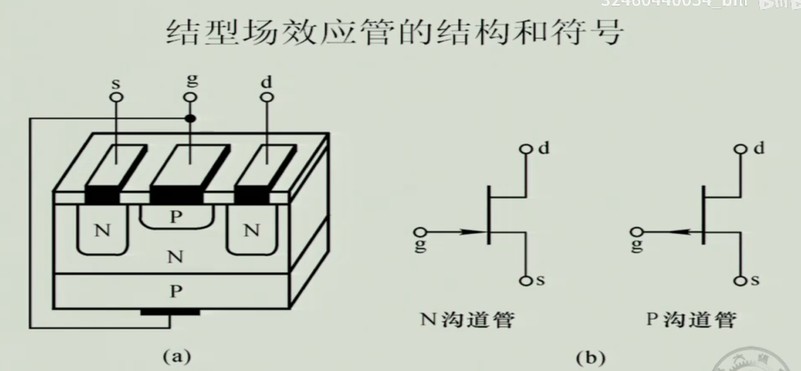
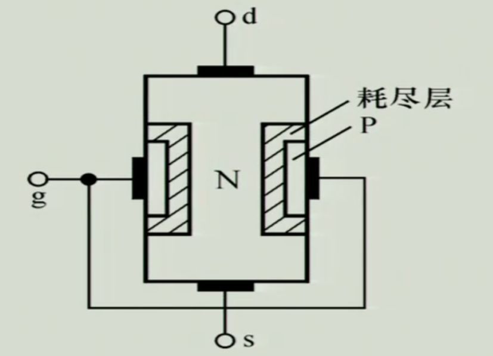

$U_{GS}$为反压减小耗尽层
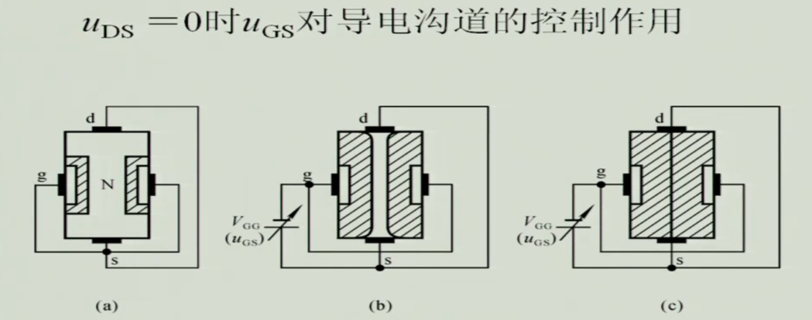

 

$U_{GS} < 0$ 

当$U_{GS} > 0$，PN结导通，非场效应管，不存在沟道
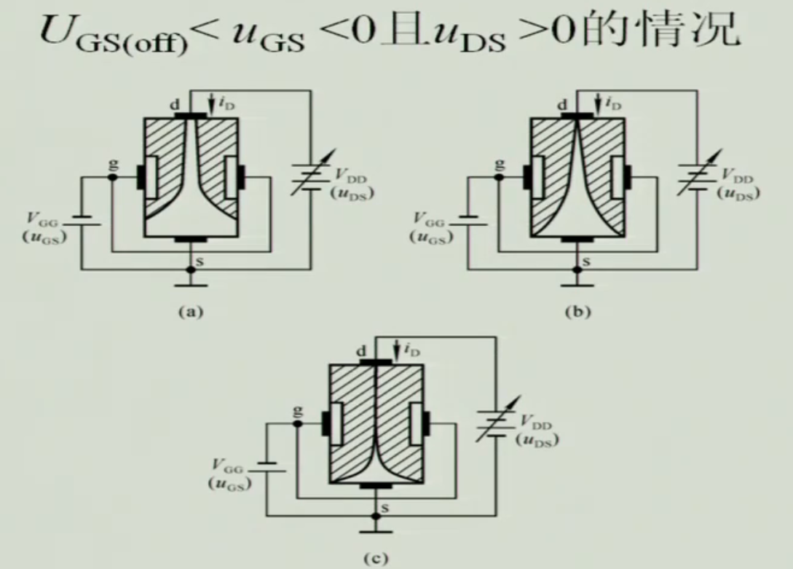

### 特性曲线

1、转移特性曲线

因$U_{GS}$对$I_{D}$有控制，画恒流条件下的特性

条件：进入恒流区，$U_{GS}$足够大

**增强型曲线**
$$i_{D} = I_{DO} \cdot (\frac{U_{GS}}{U_{GS(th)}} - 1)$$
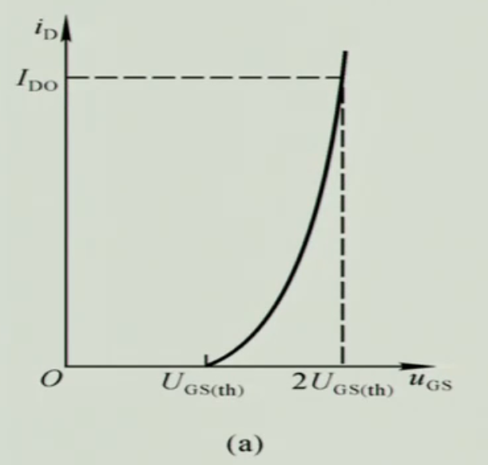

**耗尽型曲线**

$I_{DSS}饱和电流$

在红色的一段中方程为

$$i_{D} = I_{DSS} \cdot (\frac{U_{GS}}{U_{GS(th)}} - 1)$$
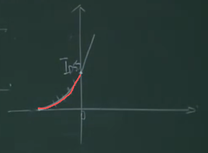

**结型管**
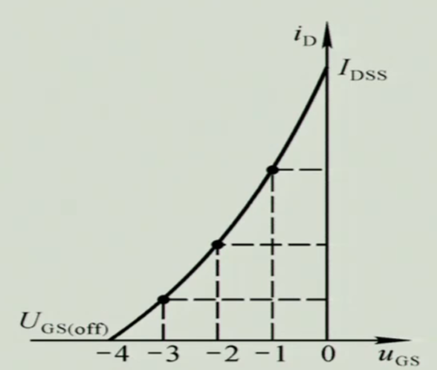
2、输出特性曲线

**增强型曲线**
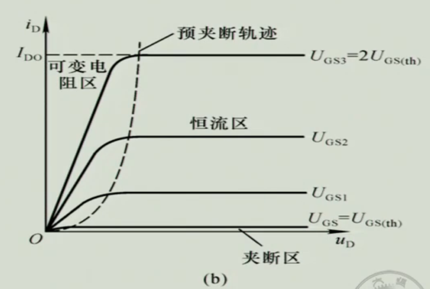

**结型管**
因曲线电压小于0，耗尽型MOS管可以有大于0的部分
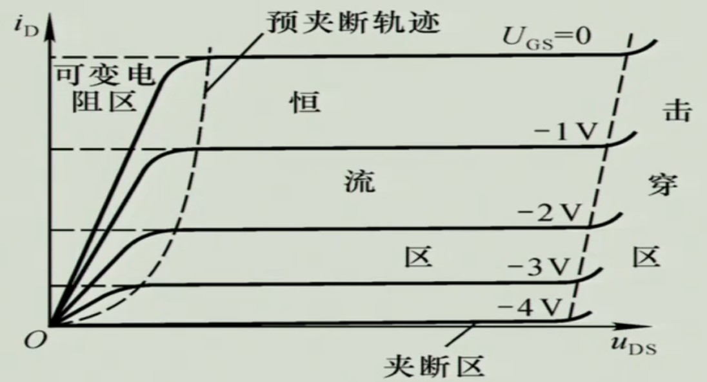

#### 总结
（1）N沟道结型管

（2）P沟道结型管

（3）N沟道增强型MOS管

（4）N沟道耗尽型MOS管

（5）P道增强型MOS管

（6）P沟道耗尽型MOS管
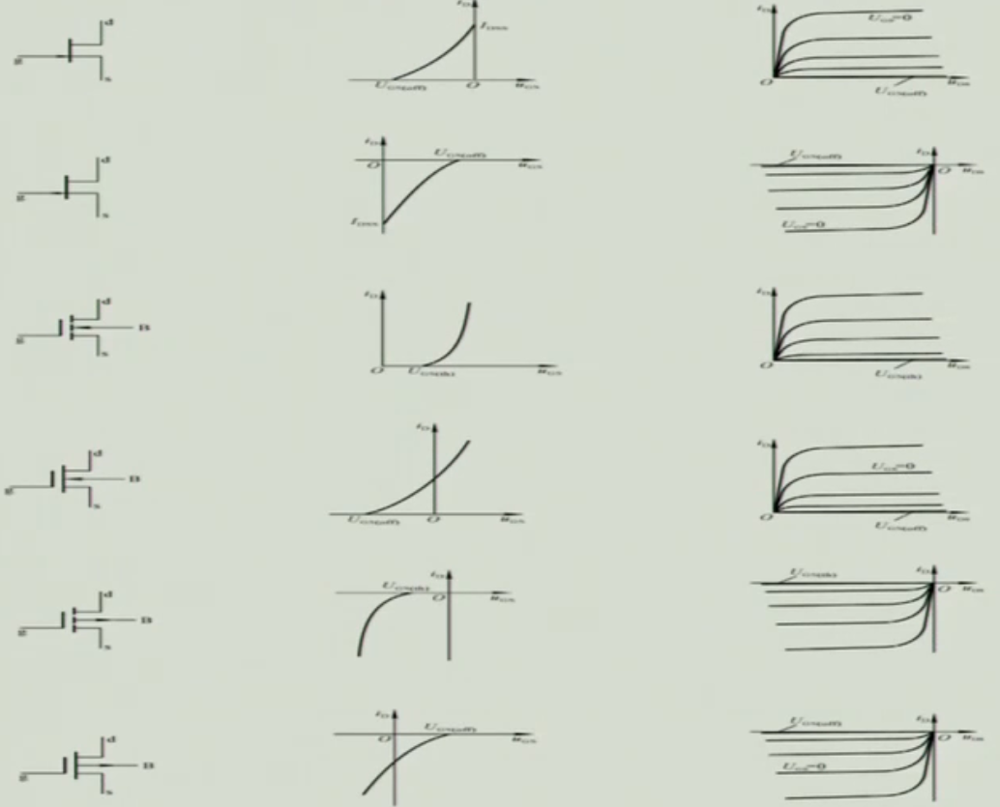

### 参数

#### 直流参数
增强型MOS管：$U_{GS(th)}$

耗尽型MOS管和结型管：$U_{GS(off)}$、$I_{DSS}$

输入电阻：$R_{GS(DC)}$（MOS管>1000MΩ）

认为绝缘的电阻值：>500MΩ

#### 交流参数
1、（低频）跨导

$$g_m = \frac{\triangle i_D}{\triangle u_{GS}} \bigg|_{U_{DS} = 常数}$$

2、极间电容

大约pF级别，高频时候会导通