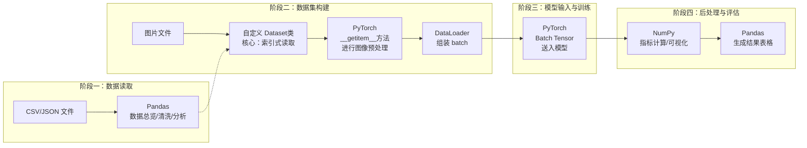

```python
# 创建人工数据集
import os
os.makedirs(os.path.join('..','data'),exist_ok=True)
data_file = os.path.join('..','data','labels.csv')

with open(data_file, 'w') as f:
    f.write('NumRooms,Alley,Price\n')   # 列名
    f.write('NA,Pave,127500\n')  # 每行表示一个数据样本
    f.write('2,NA,106000\n')
    f.write('4,NA,178100\n')
    f.write('NA,NA,140000\n')
```

# 读取数据
pandas通过读取表格，读取数据
## 表格类型
| 数据类型 | 说明 | Pandas读取方式 |
| :----: | :----: | :----: |
| csv、tsv、txt | 用逗号或tab等分隔的纯文本文件 | pd.read_csv() |
| excel | .xls或.xlsx文件 | pd.read_excel() |
| mysql | 关系型数据库表 | pd.read_sql() |
| json | 存储和交换文本信息 | pd.read_json() |
| html | 解析网页中的 HTML 表格数据，将其转换为 DataFrame | pd.read_html() |

## 表格路径
>路径问题<br>
&#x274c;使用单反斜杠<br> &emsp;&emsp;fpath='F:\labels.csv'或是fpath='data\labels.csv'<br>
&#x2705;使用r前缀或双反斜杠或单正斜杠<br>
&emsp;&emsp;fpath=r"F:\labels.csv"<br>
&emsp;&emsp;fpath="F:\\\\labels.csv"<br>
&emsp;&emsp;fpath="F:/labels.csv"<br>

## read_csv常用参数
```python
df = pd.read_csv('data.csv', sep=';', header=0, names=['A', 'B', 'C'], dtype={'A': int, 'B': float})
```


## 数据概览
```python
# 读取csv数据
import pandas as pd

fpath='./labels.csv'
# 读取数据
df = pd.read_csv(fpath)
print(df)
# 查看前五行数据
df.head()
# 查看数据形状
df.shape
# 查看列表列名(dtype='object')
df.colums
# 查看索引(一般为数字序列，一般有几行就有多少索引)
df.index
# 查看每列数据类型
df.dtypes
```

# 补充数据
## 用均值填充数值NAN
```python
inputs, outputs = data.iloc[:, 0:2], data.iloc[:, 2]
inputs = inputs.fillna(inputs.mean(numeric_only=True))   # 用均值填充NaN，numeric_only=True只针对数值列
print(inputs)
```


## 非数值填充
将NaN视为一个类别
```python
inputs = pd.get_dummies(inputs, dummy_na=True, dtype=int)
print(inputs)
```


## 数值类型转成torch的tensor格式
```python
X, y = torch.tensor(inputs.values), torch.tensor(output.values)
print(X)
print(y)
```

# 数据结构
DataFrame：二维数组，表格


Series：一维数据，表格中一行或一列。由一组数据（可能包含不同数据类型）以及一组与之相关的数据标签（索引）组成


